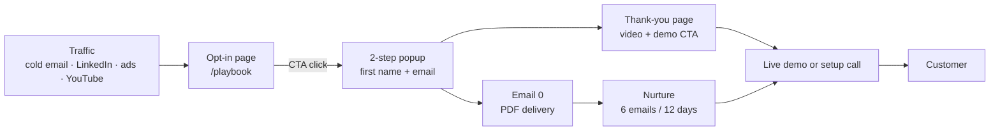

# Lead magnet funnel: The Cold Email Playbook (albdata)

Same structure as the reference "free report" funnel, rebuilt for albdata with its own content.

> Anything in `[brackets]` is a placeholder. Use only real numbers, quotes and results. Don't reuse the reference's brand, quote or endorsement.

## 1. Funnel map



| Step | Goal | Main metric |
|---|---|---|
| Opt-in page | Click the CTA | CTA click rate |
| Popup | Submit email | Opt-in rate |
| Thank-you page | Start the demo or book a call | CTA click rate |
| Email 0 | Open the PDF | PDF link clicks |
| Nurture | Book a call or start the demo | Calls booked |

## 2. Opt-in page (`/playbook`)

One screen, no menu, no other links. The only action is the CTA.

```
┌────────────────────────────────────────────────────────────┐
│ PRE-HEADLINE (small, muted)                                 │
│ HEADLINE: big claim + specific numbers + "WITHOUT ..."      │
│                                                             │
│   ┌─page 1─┐     ┌──────────────┐     ┌─page 3─┐            │
│   └────────┘     │   3D BOOK    │     └────────┘            │
│   ┌─page 2─┐     │    COVER     │     ┌─page 4─┐            │
│   └────────┘     └──────────────┘     └────────┘            │
│                                                             │
│      ┌──────────────────────────────────────────┐           │
│      │  SEND ME MY FREE PLAYBOOK NOW            │ ← green    │
│      │  (value sub-line)                        │           │
│      └──────────────────────────────────────────┘           │
│          🔒 privacy line                                    │
└────────────────────────────────────────────────────────────┘
```

**Style:** dark grey background with a subtle grid texture. Blue book cover with yellow and white title text. Fanned preview pages in white with a lime accent. Large green CTA.

### Copy

| Element | Copy |
|---|---|
| Pre-headline | Free for agency owners who run cold email for clients |
| Headline | This [X]-million-email Cold Email Playbook can book your agency an extra [5, 10 or even 20] meetings a month **WITHOUT** buying more leads or inboxes. |
| Cover quote strip | "[Real quote from a client or a known name]" — [Name, role] |
| Cover title | **THE [X] MILLION EMAIL** / **COLD EMAIL** / **PLAYBOOK** |
| Cover subtitle | How to go from 0 to [30] booked meetings a month with cold email, and keep landing in the inbox. |
| Cover brand | albdata (logo at the bottom) |
| Cover visual | Envelope or inbox icon (in place of the cash roll) |
| CTA button | SEND ME MY FREE PLAYBOOK NOW |
| CTA sub-line | (Get free what took us [X] million emails to learn) |
| Trust line | 🔒 100% privacy. No spam. Unsubscribe in one click. |

### Fanned preview pages (4 chapters)

| Position | Page title | What the page shows |
|---|---|---|
| Top left | **The Spam Folder Trap** | Why most campaigns never reach the inbox. Checklist: SPF/DKIM/DMARC, secondary domains, 2–3 inboxes per domain, 30–50 sends a day per inbox, 2–3 weeks of warmup. |
| Bottom left | **The 3-Line Email Framework** | Annotated sample email with callouts: hook line, relevance line, low-friction CTA, `{{firstName\|there}}`, spintax. |
| Top right | **Match the Email to the Lead** | Lead list → personalised first line, shown as an arrow from a lead record to the email. |
| Bottom right | **Follow-ups: Winning the Inbox War** | A 4-step sequence timeline that stops on reply and threads follow-ups as replies. |

### Optional below the fold

What's inside (6 bullets) → author or agency bio with a real proof number → 2–3 testimonials → the CTA again.

## 3. Two-step popup

Opens when the CTA is clicked. Visitors who already clicked once are more likely to finish the form.

- **Heading:** Where should we send your playbook?
- **Fields:** First name, Work email (no other fields)
- **Button:** Send it to me →
- **Below the button:** the privacy line, plus a consent checkbox for EU traffic
- **Hidden fields:** `utm_source`, `utm_medium`, `utm_campaign`, `utm_content`, referrer

## 4. Thank-you page (`/playbook/thanks`)

- **Headline:** Done! Your playbook is on its way to `{{email}}`.
- **Progress bar:** ✅ Step 1: Get the playbook → ▶ Step 2: Watch this 3-min video
- **Video:** "How to launch a campaign that lands in the inbox" (3 min, a live walkthrough in albdata)
- **Primary CTA:** Try albdata live in your browser, free (the existing Codespaces demo)
- **Secondary CTA:** Book a 15-min setup call
- **Small print:** Not in your inbox in 5 minutes? Check Promotions or Spam, and add `[sender]` to your contacts.

## 5. The playbook (placeholder PDF)

`playbook.pdf` is a placeholder for now. Target length is 20–30 pages, and every chapter ends with a "Do this in albdata" box.

1. The Spam Folder Trap (deliverability and DNS)
2. Warmup: the 3-week runway
3. Building the list (Lead Finder, verification, dedupe)
4. Match the Email to the Lead (personalisation and variables)
5. The 3-Line Email Framework (copy and A/B variants)
6. Follow-ups: Winning the Inbox War (sequences and timing)
7. From reply to deal (Unibox labels → CRM pipeline)
8. Reporting results to clients (client report links)

## 6. Email sequence

| # | Day | Subject | Goal | CTA |
|---|---|---|---|---|
| 0 | 0 (instant) | Your Cold Email Playbook (inside) | Deliver the PDF | Download PDF |
| 1 | 1 | Check this before you send another email | Quick win: DNS check (chapter 1) | Read chapter 1 |
| 2 | 3 | The 3 lines that get replies | Teach the framework and show an example | Try it in the demo |
| 3 | 5 | The follow-up most agencies never send | Teach sequences | Read chapter 6 |
| 4 | 7 | [Client] booked [X] meetings in [Y] days | Case study (real) | Book a call |
| 5 | 9 | Why we self-host our cold email | Handle objections: data on your server, one place for every client | Try the demo |
| 6 | 12 | Should I close your file? | Last call | Book a call |

**Exit rules:** stop the sequence when the lead books a call, starts the demo or unsubscribes. Leads who click 2+ links get tagged as hot and receive a personal follow-up.

## 7. Tracking and targets

**Events:** `page_view` → `cta_click` → `optin_submit` → `thankyou_cta_click` → `pdf_click` → `demo_start` → `call_booked`. Store UTMs on the lead.

The targets below are starting points. Review them after 2 weeks of traffic.

| Metric | Target |
|---|---|
| Page → CTA click | 40%+ |
| CTA click → opt-in | 60%+ |
| Page → opt-in (overall) | 25%+ |
| Email 0 open rate | 50%+ |
| Thank-you CTA click | 10%+ |
| Lead → call or demo (12 days) | 3–5% |

## 8. Build notes (later)

- **Pages:** add public `/playbook` and `/playbook/thanks` routes. Put the form endpoint under `/api/public/` (already public in `src/middleware.ts`).
- **Storage:** save each opt-in as a `Lead` in a "Playbook opt-ins" list, with `source = "playbook"` and UTMs plus the consent timestamp in `customFields`.
- **Sending:** send Email 0 and the nurture emails from your main-domain inbox or a transactional provider, **not** from cold-email domains. Opt-ins have given consent, so keep their reputation separate.
- **Compliance:** include an unsubscribe link in every nurture email. Use double opt-in for EU leads.
